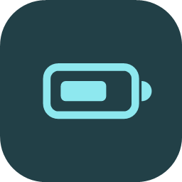
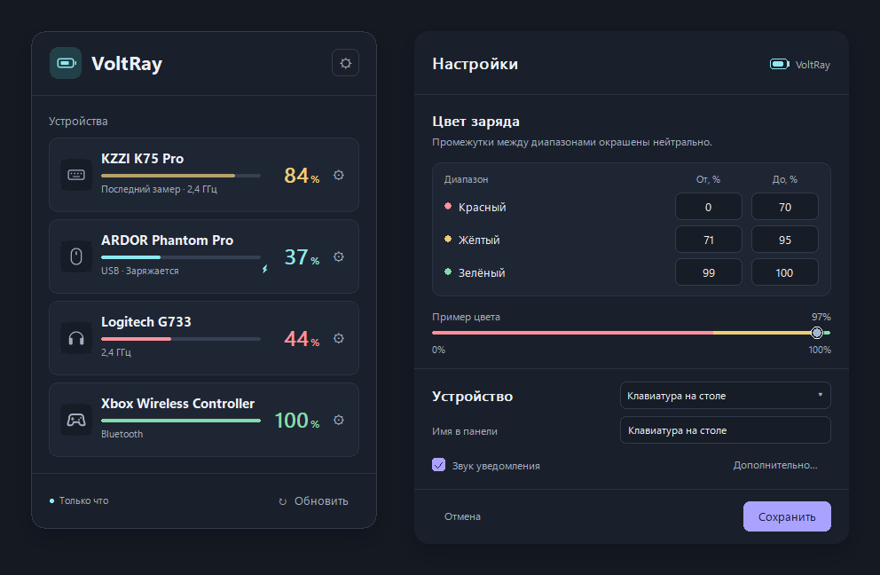
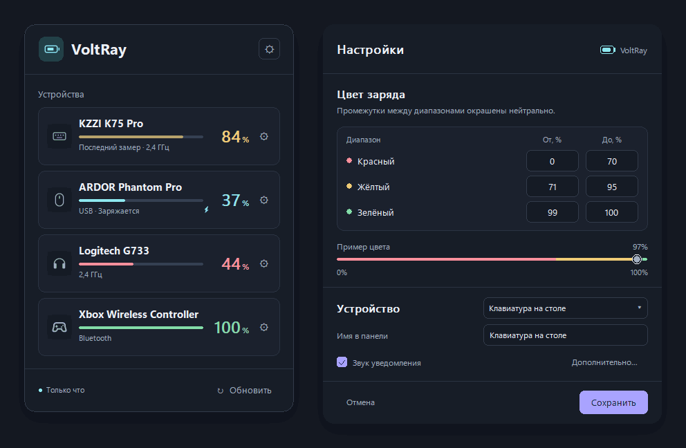
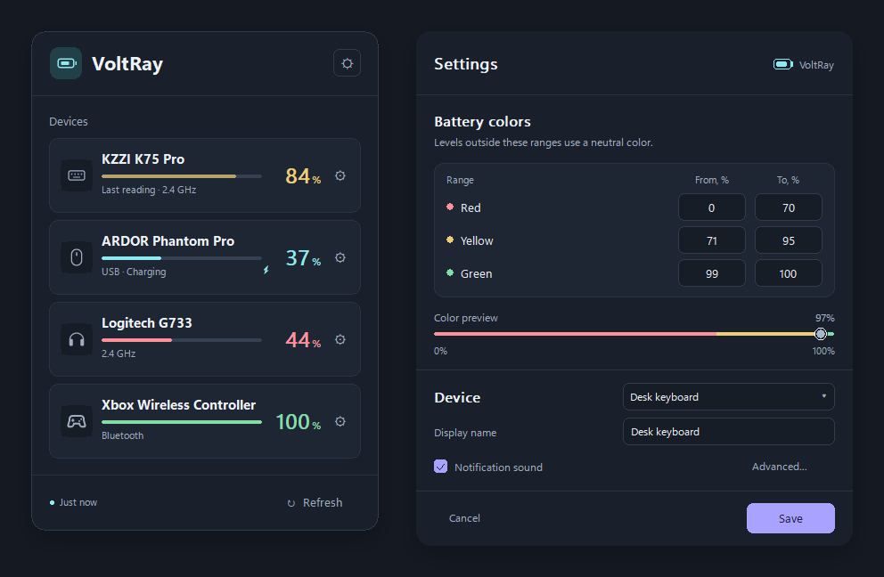
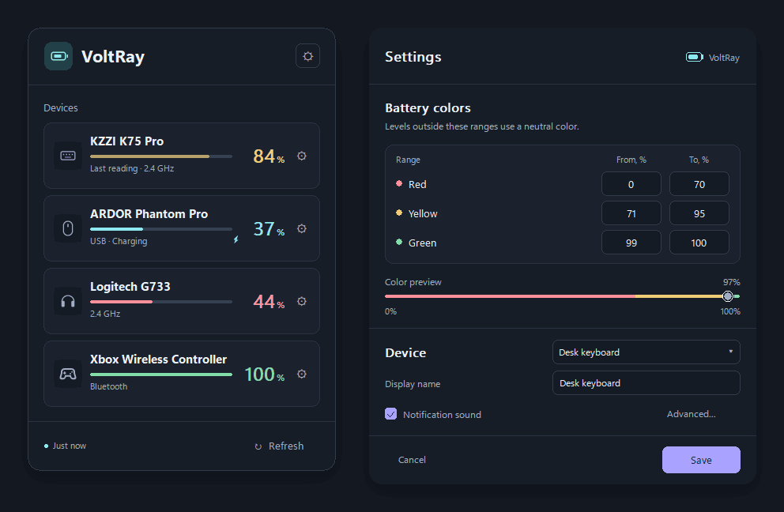

<p align="center"></p>
<h1 align="center">VoltRay</h1>
<p align="center"><a href="#русский">Русский</a> · <a href="#english">English</a></p>

## Русский

VoltRay показывает заряд мыши, гарнитуры, клавиатуры и геймпада в области уведомлений Windows 11. В одной панели видны проценты, полосы заряда, тип подключения и состояние зарядки.

**[Скачать VoltRay v13.0.0 для Windows 11 x64](https://github.com/chlenonozka/VoltRay/releases/download/v13.0.0/VoltRay-v13.0.0-win-x64.zip)** · [Все выпуски](https://github.com/chlenonozka/VoltRay/releases)

### Интерфейс





На иллюстрациях показан интерфейс VoltRay с демонстрационными показаниями.

### Возможности

| Функция | Как работает |
| --- | --- |
| Панель заряда | До четырёх устройств, по одному на категорию. При наличии показаний отображаются процент и полоса заряда. Рядом видны тип подключения и статус «Заряжается», а полоса при зарядке меняет цвет. |
| Последний замер | Если устройство уснуло, отключилось или перестало отдавать процент, последний известный заряд остаётся виден с соответствующей пометкой. Замер сохраняется между запусками. Если замера ещё не было, вместо процента отображается тире. |
| Значки в трее | Значок каждой категории можно включать и скрывать отдельно. Он показывает индикатор заряда, а по выбору и цифры процента. Подсказка при наведении показывает имя устройства и его состояние. |
| Выбор и имя устройства | VoltRay автоматически выбирает подключённое устройство в каждой категории. Можно закрепить конкретное устройство через меню значка. По умолчанию используется имя из Windows, а в настройках можно задать имя для VoltRay. |
| Цвета заряда | Для каждой категории можно настроить три цвета и шесть границ от 0 до 100%, а также отдельный цвет зарядки. Границы включены, диапазоны могут идти в любом порядке и не должны пересекаться. В промежутках цвет нейтральный. Ползунок показывает цвета диапазонов до сохранения. По умолчанию заданы 0–20%, 21–74% и 75–100%. |
| Уведомления | Для каждой категории можно включить предупреждение о низком заряде и задать порог от 0 до 100%. VoltRay учитывает свежие показания и пропускает предупреждение во время зарядки. Можно прослушать и выбрать системный звук Windows или собственный файл WAV. |
| Оформление | Системная, светлая и тёмная темы с поддержкой высокой контрастности Windows. Интерфейс на русском и английском. |
| Обновление | VoltRay опрашивает устройства в фоне, обновляет показания чаще при открытой панели и реагирует на подключение и отключение. Кнопка **Обновить** запускает проверку вручную. |

### Поддерживаемые устройства

| Подключение | Что требуется для отображения процента |
| --- | --- |
| Bluetooth | Устройство передаёт уровень заряда, доступный через Bluetooth LE Battery Service или Windows. По Bluetooth LE проверен Xbox Wireless Controller. |
| USB-приёмник 2,4 ГГц | Встроены профили для Logitech G733, ARDOR GAMING Phantom PRO / Phantom PRO V2 и KZZI K75 Pro. Для KZZI K75 Pro нужна установленная прошивка, которая передаёт заряд совместимым способом. |
| USB-кабель | Процент доступен, если устройство отдаёт показания в проводном режиме способом, который поддерживает VoltRay. Для Phantom PRO и Phantom PRO V2 предусмотрены проводные профили. |

Процент зависит от модели, прошивки и режима подключения. При отсутствии данных VoltRay показывает состояние подключения и, если он сохранился, последний замер.

### Как пользоваться

1. Распакуйте архив и запустите `VoltRay.exe`. Установка не требуется. Если значки свёрнуты, откройте меню скрытых значков Windows рядом с часами.
2. Щёлкните левой кнопкой по значку, чтобы открыть панель. Щёлкните правой, чтобы выбрать устройство, включить **Цифры на значке**, открыть настройки, обновить заряд или выйти.
3. Нажмите шестерёнку в строке устройства, чтобы изменить цветовые диапазоны, цвет зарядки или имя. В **Дополнительно…** можно задать порог уведомления, выбрать и прослушать звук, показать или скрыть значок и сбросить цвета.
4. Откройте меню со значком луны или солнца в правом верхнем углу панели, чтобы выбрать тему, язык или набор значков. Для переключения на русский выберите **Language → Русский**. Если все значки скрыты, запустите `VoltRay.exe` ещё раз. Откроется панель уже работающего приложения.

### Сборка из исходников

VoltRay написан на C++20 и использует Win32. Для сборки под Windows x64 распакуйте UCRT-архив из выпуска [LLVM-MinGW 20261104](https://github.com/mstorsjo/llvm-mingw/releases/tag/20261104).

Выполните команду в PowerShell из корня репозитория.

```powershell
.\build.ps1 -ToolchainDir 'C:\Tools\llvm-mingw-20261104-ucrt-x86_64'
```

Можно запустить `.\build.ps1` без параметра, если `clang++.exe` и `llvm-rc.exe` из LLVM-MinGW доступны через `PATH`. Готовый файл появится по пути `dist\VoltRay.exe`.

## English

VoltRay shows the battery levels of your mouse, headset, keyboard, and gamepad in the Windows 11 system tray. Its flyout shows percentages, battery bars, connection types, and charging status at a glance.

**[Download VoltRay v13.0.0 for Windows 11 x64](https://github.com/chlenonozka/VoltRay/releases/download/v13.0.0/VoltRay-v13.0.0-win-x64.zip)** · [All releases](https://github.com/chlenonozka/VoltRay/releases)

### Interface





The images show the VoltRay interface with sample readings.

### Features

| Feature | How it works |
| --- | --- |
| Battery flyout | View up to four devices, one per category, with their percentages, battery bars, and connection types. The status and bar color change when a device reports that it is charging. |
| Last reading | If a device goes to sleep, disconnects, or stops reporting a percentage, VoltRay labels and displays its last known reading. The reading survives app restarts. A dash appears until a reading is available. |
| Tray icons | Show or hide each category icon independently. An icon has a battery indicator and can display percentage digits. Hover over an icon to see the device name and status. |
| Device selection and names | VoltRay automatically chooses a connected device for each category. Use the tray icon menu to pin a specific device. VoltRay uses the Windows device name by default and lets you set a name for its own interface. |
| Battery colors | Customize three colors, six endpoints from 0 to 100%, and a separate charging color for each category. Endpoints are inclusive, bands can go in any order, and overlaps are disallowed. Gaps use a neutral color. Preview the ranges with the slider before saving. The default bands are 0–20%, 21–74%, and 75–100%. |
| Low-battery alerts | Enable alerts and set a threshold from 0 to 100% for each category. VoltRay uses fresh readings and skips alerts while the device is charging. Choose a Windows sound or a custom WAV file and preview it in settings. |
| Appearance | Choose the system, light, or dark theme with support for Windows high contrast. The interface is available in English and Russian. |
| Refresh | VoltRay polls in the background, refreshes more often while the flyout is open, and responds to devices connecting or disconnecting. Use **Refresh** to check manually. |

### Supported devices

| Connection | What a battery reading requires |
| --- | --- |
| Bluetooth | The device exposes a battery level through the Bluetooth LE Battery Service or Windows. The Xbox Wireless Controller was tested over Bluetooth LE. |
| 2.4 GHz USB receiver | Built-in profiles cover Logitech G733, ARDOR GAMING Phantom PRO / Phantom PRO V2, and KZZI K75 Pro. The KZZI K75 Pro requires installed firmware that reports charge in a compatible format. |
| Wired USB | A percentage is available when the device reports it through a method VoltRay supports in wired mode. Wired profiles are included for the Phantom PRO and Phantom PRO V2. |

Percentage availability depends on the model, firmware, and connection mode. When a reading is unavailable, VoltRay shows the connection status and any saved reading for that device.

### Getting started

1. Extract the ZIP and run `VoltRay.exe`. No installation is required. If you do not see the icons, open the hidden icons menu next to the Windows clock.
2. Left-click an icon to open the flyout. Right-click to select a device, enable **Numbers on icon**, open settings, refresh, or quit.
3. Use the gear beside a device to change its color ranges, charging color, or display name. In **Advanced…**, set the alert threshold, pick and preview a sound, show or hide the tray icon, or reset the colors.
4. Open the moon or sun menu at the top right of the flyout to choose the theme, language, or set of tray icons. To switch from Russian to English, choose **Язык → English**. If you hide every icon, run `VoltRay.exe` again to open the current instance’s flyout.

### Build from source

VoltRay is written in C++20 and uses Win32. To build for Windows x64, extract the UCRT archive from [LLVM-MinGW 20261104](https://github.com/mstorsjo/llvm-mingw/releases/tag/20261104).

Run this command in PowerShell from the repository root.

```powershell
.\build.ps1 -ToolchainDir 'C:\Tools\llvm-mingw-20261104-ucrt-x86_64'
```

You can run `.\build.ps1` without an argument if LLVM-MinGW’s `clang++.exe` and `llvm-rc.exe` are on `PATH`. The executable is written to `dist\VoltRay.exe`.
